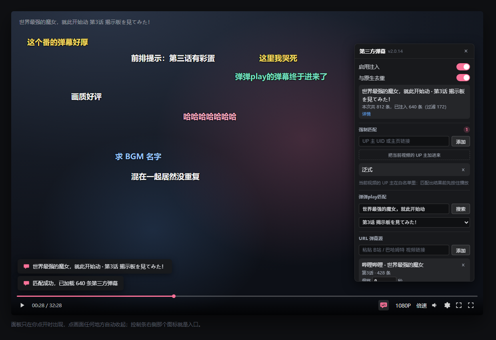

# Danmaku Enhance

> 基于 [agefans enhance](https://github.com/IronKinoko/agefans-enhance) 的 fork。
> 除了保留原来的「替换播放器」能力，额外做了一件事：**把第三方弹幕注入哔哩哔哩的原生播放器**。

弹弹play上有弹幕，B 站上有你习惯的播放器 —— 这个脚本把它们拼在一起。不换播放器、不装插件、
不改 B 站的任何设置，打开开关，正在看的那个视频就会多出一路弹幕。

## 哔哩哔哩：它到底做了什么

B 站播放器是按 6 分钟一段去拉弹幕的：

```
GET api.bilibili.com/x/v2/dm/web/seg.so?type=1&oid=<cid>&segment_index=<n>
→ protobuf（DmSegMobileReply，里面是 DanmakuElem 列表）
```

脚本在页面里接管这个请求：自己把弹幕取回来，和第三方源合并，**再把合并后的响应交还给播放器**。
播放器拿到的仍然是它认识的那份 protobuf，所以：

- 播放器没被替换，快捷键、清晰度切换、倍速、网页全屏全都是原生那套
- 弹幕的渲染、字号、透明度、速度、屏蔽词也仍然是 B 站自己的设置
- 注入的弹幕和原生弹幕在同一个图层、同一条轨道上跑，不存在「两套弹幕速度不一样」的割裂感

配套的东西还有：标题自动匹配番剧、多路 URL 弹幕源、对全部弹幕生效的过滤器、可调时间偏移。



> 上图是把真实的面板样式（`src/adapter/bilibili/index.scss`）套在一个模拟的播放器里渲染出来的示意图，
> 用来展示控件长什么样、面板挂在控制条上方哪个位置；画面上飘的弹幕是假的。

## 功能

### 哔哩哔哩

- **弹幕混流**：弹弹play的弹幕并进 B 站原生弹幕流，播放器不动
- **多源并存**：弹弹play、哔哩哔哩链接、巴哈姆特动画疯链接可以同时挂着，最多 3 条 URL 源
- **智能匹配**：标题清洗后逐级尝试多组关键词，按最长公共子串筛掉无关结果，季度/集数都有对应规则；
  匹配不确定时列出候选让你选，也可以手动搜索
- **过滤器对全部弹幕生效**：屏蔽词、屏蔽滚动/顶部/底部、合并相似弹幕、每分钟上限 ——
  原生弹幕和注入弹幕一视同仁
- **时间偏移**：每条 URL 源一个独立偏移量，可正可负，改完即时生效
- **UP 主白名单**：把常看的 UP 主加进白名单，他们的视频匹配好了才开播 ——
  救回「先播几秒才选集」时注定丢掉的第一段弹幕；自己点播放就立刻放行，不耽误看
- **面板藏在控制条里**：控制条右侧一个图标按钮，点开才出现，点面板外面自动收起
- **按 cid 记忆**：匹配结果、URL 源、偏移量都按视频记住，下次打开还是老样子

### 其它站点

替换掉站点自带播放器，得到一个功能完整的播放器：

- 弹幕
- 画中画
- 自动换集、无缝换集
- 超多快捷键，支持自定义
- 调整播放器外边框，适配视频比例
- 记录播放位置，自动续播
- 按 <kbd>?</kbd> 键调出脚本信息窗口，查看**视频信息**与**快捷键**
- 多站点适配，可搜索相同视频资源/种子

## 支持的网站

| 站点 | 处理方式 |
| --- | --- |
| [哔哩哔哩](https://www.bilibili.com) | 不替换播放器，把第三方弹幕混进原生弹幕流 |
| [agefans](http://www.age.tv) | 替换播放器 |
| [bimiacg](http://www.bimiacg14.net) | 替换播放器 |
| [次元城](https://www.cycani.org) | 替换播放器 |
| [稀饭动漫](https://next.xifanacg.com) | 替换播放器 |
| [Anime1](https://anime1.me) | 替换播放器 |
| [咕咕番](https://www.gugu3.com) | 替换播放器 |
| [girigiri 爱](https://anime.girigirilove.com/) | 替换播放器 |
| [吐槽弹幕网](https://www.tucao.my/) | 替换播放器 |
| [独立播放器](https://ironkinoko.github.io/agefans-enhance/) | 替换播放器 |

哔哩哔哩这边只处理视频页与番剧/影视播放页，**直播页直接跳过**（直播没有分段弹幕接口）。

## 安装

1. 先装 [Tampermonkey](https://www.tampermonkey.net/)（Violentmonkey 也可以）
2. 点这里安装脚本：[index.user.js](https://github.com/IYIAK/agefans-enhance-for-bilibilli/raw/gh-pages/index.user.js)

推送 `master` 后由 GitHub Actions 自动构建并发布到 `gh-pages` 分支，上面这个地址永远是最新构建。

## 哔哩哔哩怎么用

0. 打开任意视频，点控制条右侧的弹幕图标，打开面板里的「启用注入」开关
1. 面板会按当前标题自动匹配番剧；匹配不准就手动搜索，或者直接把一个视频链接贴进 URL 弹幕源
2. 时间对不上，填偏移量；弹幕太吵，用过滤器
3. 想确认装的是不是最新版：面板标题旁常驻显示当前运行的版本号

> **已经播了一会儿才打开开关，当前这一段可能没有注入弹幕。**
> B 站播放器会把请求过的分段缓存在内存里，插件没法让它重发。面板会提示「本段已缓存」，
> 点旁边的刷新图标（或直接刷新页面）再打开开关即可。

## 常见问题

**匹配到的番剧不对 / 搜不到？**
弹弹play的搜索是纯子串包含，而且最多只返回 25 条、按 id 排序 —— **结果 0 条不代表库里没有**。
用面板里的手动搜索框输入更长、更接近原名的一段；或者在 B 站找到对应视频，直接把链接贴进 URL 弹幕源。

**会和 B 站原生弹幕重复吗？**
默认开启「与原生去重」：忽略空白、标点、全角半角和大小写做文本比对，撞原生 ±1.5 秒、
注入之间 ±1.8 秒都算重复。想让两边都显示，把开关关掉。

**支持直播吗？**
不支持。直播页没有分段弹幕接口，脚本会直接跳过。

**会影响原来 agefans 那些站点的功能吗？**
不会。哔哩哔哩走的是独立适配层，只接管弹幕分段请求和面板，原来替换播放器的那套逻辑一行没动。

## 权限声明

| 权限 | 用途 |
| --- | --- |
| `GM_xmlhttpRequest` | 请求弹幕接口。仅访问 **dandanplay.net**、**api.bilibili.com**、**ani.gamer.com.tw** |
| `GM_getValue` / `GM_setValue` | 保存播放器配置、匹配结果、URL 弹幕源与偏移量 |
| `GM_info` | 在面板里显示当前运行的脚本版本 |
| `GM_registerMenuCommand` | 注册脚本菜单项 |
| `@include` | 匹配上面列出的站点 |

跨域白名单写死在 `meta.template` 的 `@connect` 里，你也可以在 Tampermonkey 的
「设置 → XHR 安全」里逐条管理。所有数据都存在本地，不上传任何地方。

## 版本号规则

本项目从 fork 起点（上游基线 1.60.3）重新计数：

- `2.0.0` = 「哔哩哔哩弹幕注入」做到能日常用的那一刻
- 之后**修复与收尾涨修订号**（`2.0.11`、`2.0.12`）
- **新功能涨次版本号**（`2.1.0`、`2.2.0`）

早期那批 `1.60.4`～`1.60.9` 是沿用上游主次号的临时编号，已按新规则对应过来。

## 开发

```bash
pnpm install
pnpm dev      # 监听构建（bocchi）
pnpm build    # 产出 dist/index.user.js
pnpm lint     # tsc --noEmit
```

源码结构：

```
src/
├── index.ts              # 入口：样式 + 适配层 + runtime.run()
├── runtime/              # 站点注册、SPA 路由、单例运行时
├── player/               # KPlayer（基于 Plyr）与插件：弹幕、快捷键、自动换集
├── adapter/
│   ├── <站点>/           # 各站点适配器
│   └── bilibili/         # 哔哩哔哩注入：见下
└── utils/                # 存储、请求、UI 小工具
```

`src/adapter/bilibili/` 里各文件的职责：

| 文件 | 职责 |
| --- | --- |
| `hook.ts` | 接管 XHR/fetch，把第三方弹幕合并进分段响应 |
| `proto.ts` | 最小 protobuf 编解码（只处理用到的字段，其余原样搬运） |
| `match.ts` | 标题清洗、候选关键词、番剧/集数匹配 |
| `info.ts` | 从页面状态里读当前视频的标题、cid、集数 |
| `panel.ts` | 控制条按钮 + 弹出面板 |
| `sources/` | URL 弹幕源：哔哩哔哩、巴哈姆特动画疯 |
| `filters.ts` | 弹幕过滤器（对原生 + 注入同时生效） |
| `store.ts` | 配置与 URL 源的持久化 |

官网在 `site/`（一页介绍 + 一页更新日志），纯静态、零外部依赖，构建方式见 `site/README.md`。

## 致谢与许可

- 上游项目：[IronKinoko/agefans-enhance](https://github.com/IronKinoko/agefans-enhance)
- 弹幕服务：[弹弹play](https://www.dandanplay.com/)
- 弹幕渲染库：[@ironkinoko/danmaku](https://github.com/IronKinoko/danmaku)

MIT License，见 [LICENSE](./LICENSE)。
